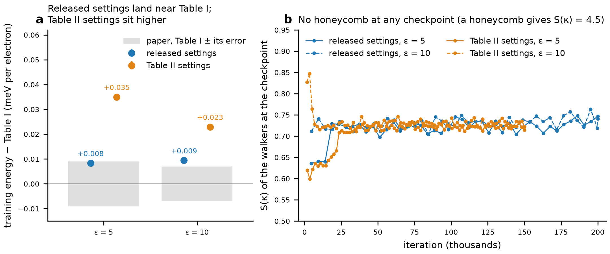
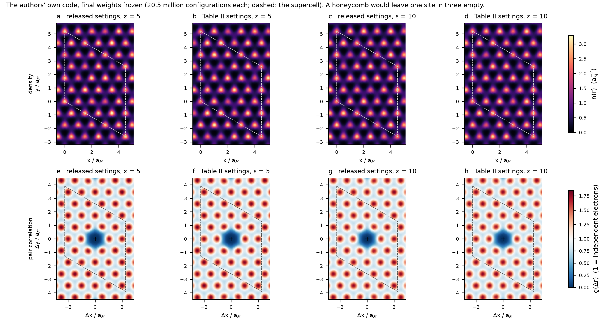

# authors_exact_code_runs — the authors' exact code, and what their two sets of settings give

Collected here on 2026-11-16. Everything about the runs made with the **authors' own code** (not
ours) for the paper's 18-electron system: the runs, their analysis, and the comparison of the two
sets of settings. The two run folders were moved here from `runs/stage08/` with `git mv` (history
kept, no file changed); each old folder now holds only a `MOVED.md` that points here. Nothing in
`learn/` changed.

## What "exactly their code" means

- The program: `external/PeriodicWave` at their published commit
  `6525d2f3eec53f085b55d485e1bff45d61ef1782`, no file of it changed.
- Started with their own script, `periodicwave/configs/run_2deg_triangular_potential.py`, and their
  arguments: `18_0 27 0.35 <1/eps> 8.031 15 45 CustomPsiformer` (18 electrons, 27 sites, m* = 0.35,
  eps = 5 or 10, a_M = 8.031 nm, V = 15 meV, phi = 45 degrees, the self-attention network).
- No line of ours runs inside the training. Around it, only: one GPU made visible, the output kept
  in `logs/`, two passive monitors (GPU, CPU/memory, every 10 s) and a check before each run that
  the GPU can start a program (`how_this_was_started.sh` in each run folder).

## The two sets of settings

| setting | released (their script as published) | Table II (the paper, p. 7) |
|---|---|---|
| walkers | 1024 | 4096 |
| iterations | 200,000 | 150,000 |
| learning rate | 0.1 / (1 + t/20,000) | 10 / (1 + t/100,000) |
| attention layers | 4 | 3 |
| attention heads | 4 | 6 |
| perceptrons per layer | 2 | 1 |

Everything else is the same in both (4 determinants, clipping 5, KFAC norm constraint 1e-3 and
damping 1e-3, ...). The Table II runs use a copy of their script with exactly these seven numbers
changed (`runs/18_electrons_27_sites_table2_settings/changes.diff`). `code/settings_analysis.py`
checks, in the `config.json` files the authors' code itself wrote, that the two settings differ in
these seven numbers and nothing else, and that eps = 5 and 10 differ only in the interaction strength.

## What is in this folder

    README.md                      this file
    code/settings_analysis.py      the comparison of the four runs, with its checks (new)
    code/evaluate_authors_weights.py   the frozen-weight evaluation of a finished run (see below)
    code/test_evaluate_authors_weights.py, launch_evaluation.sh, evaluation_results.py
    code/launch_evaluation_eps3.sh, eps3_evaluation_results.py, eps3_checkpoint_structure.py   eps = 3
    code/launch_evaluation_seed42.sh, seed42_evaluation_results.py   eps = 3, seed 42
    results/settings_comparison.csv    one row per run: settings, energy, paper, difference, S(kappa)
    results/frozen_energies.csv, frozen_structure.csv, frozen_site_pattern.csv   the frozen weights
    figures/settings_comparison.png    the figure below
    figures/frozen_density_pair_correlation.png   density and pair correlation, frozen weights
    logs/                          the evaluation queues (GPU and CPU monitors every 10 s)
    runs/
      18_electrons_27_sites_released_settings/   their script unchanged; eps = 5, then eps = 10
      18_electrons_27_sites_table2_settings/     their script with Table II's seven numbers; eps = 10, then eps = 5
      18_electrons_27_sites_eps3_released_settings/   their script unchanged at eps = 3, self-attention
                                                 AND SlaterNet (asked for by the professor, started 2026-11-17)
      18_electrons_27_sites_eps3_seed42/   eps = 3, self-attention, seed 42 (2026-11-19): ordinary training,
                                                 and a honeycomb field for 20,000 iterations then off;
                                                 BOTH ended in the honeycomb, 0.20 meV per electron below the
                                                 first eps = 3 run (frozen weights); see its README
        Each: README.md (the run's history, day by day, and its results), how_this_was_started.sh,
        results/2deg-CoulombMoire/CustomPsiformer/<parameters>/ (what THEIR code wrote:
        config.json, train_stats.csv = the energy of every iteration, qmcjax_ckpt_<step>.npz =
        checkpoints every 30 minutes), analysis/ (summary.csv, checkpoint_structure_eps5.csv,
        checkpoint_structure_eps10.csv, checkpoint_structure.png), logs/, and the partial output of
        the starts lost to GPU faults (lost_gpu_*/, stopped_*/).

## Results

All four runs ran to their last iteration (finished between 2026-11-12 and 11-14); starts lost
earlier to GPU faults are kept apart in `lost_gpu_*/` and are not used.
Energies are **training averages**: the mean of the energy over the last 20 % of the iterations
(40,000 rows released, 30,000 rows Table II), in meV per electron, with a blocking error.

| settings | eps | energy | paper, Table I | difference | in paper error bars | S(kappa), last 20 % pooled | S(kappa) over all checkpoints | checkpoints |
|---|---|---|---|---|---|---|---|---|
| released | 5 | -59.1187(1) | -59.127(9) | +0.008 | 0.9 | 0.729 | 0.64 to 0.75 | 43 |
| released | 10 | -32.0606(1) | -32.070(7) | +0.009 | 1.3 | 0.738 | 0.70 to 0.76 | 44 |
| Table II | 5 | -59.0920(1) | -59.127(9) | +0.035 | 3.9 | 0.722 | 0.60 to 0.73 | 85 |
| Table II | 10 | -32.0471(1) | -32.070(7) | +0.023 | 3.3 | 0.731 | 0.71 to 0.85 | 79 |

A honeycomb crystal (the paper's Fig. 6 at eps = 5) gives S(kappa) = 4.5 and sublattice shares
0, 1/2, 1/2. All four runs have shares of 0.33 each.

What this shows:

- **With its released settings the authors' code reproduces Table I**: within 0.9 and 1.3 of the
  paper's error bars at eps = 5 and 10.
- **With the Table II settings it does not**: 3.9 and 3.3 error bars above, at the energy our own
  code reaches with the Table II settings (training means about -59.093 and -32.047). So our
  code's distance from Table I is not a difference between the two codes: the authors' code with
  the same settings lands at the same energy.
- **No honeycomb in any of the four runs**, at any of the 251 checkpoints, eps = 5 included.

What it does not show:

- That Table I was made with the released settings. The numbers suggest it; one run per case, each
  with its own random start, cannot show it.
- Frozen-weight energies: these are training averages (the weights still change a little from row
  to row). For our own runs the frozen-weight energy came out 0.01 to 0.02 meV per electron above
  the training average.
- Why the paper's Fig. 6 shows a honeycomb: no run of the authors' code, with either settings,
  shows one.

## The same runs with their final weights frozen (2026-11-16)

The energies above are training averages. `code/evaluate_authors_weights.py` evaluates each run's
FINAL weights, held fixed: the authors' network, sampler and local energy, built as their train.py
builds them, the configuration rebuilt by running the script each run was started with and
required to equal the `config.json` their code wrote (`test_evaluate_authors_weights.py`, 7 tests).
20,480,000 configurations per run, as in our own evaluations; each passed its check against the
end of its training. `code/evaluation_results.py` makes the tables and the figure with the same
functions (from `learn/`, unchanged) as for our runs. Run 2026-11-16 01:33 to 03:57 on both GPUs.

| run | eps | energy, frozen weights | training average (above) | paper, Table I | frozen - paper | S(kappa) | site occupations |
|---|---|---|---|---|---|---|---|
| authors' code, released settings | 5 | -59.1015(2) | -59.1187(1) | -59.127(9) | +0.026 | 0.725 | 0.53 to 0.72 |
| authors' code, Table II settings | 5 | -59.0773(2) | -59.0920(1) | -59.127(9) | +0.050 | 0.725 | 0.53 to 0.73 |
| authors' code, released settings | 10 | -32.0487(1) | -32.0606(1) | -32.070(7) | +0.021 | 0.733 | 0.54 to 0.74 |
| authors' code, Table II settings | 10 | -32.0345(1) | -32.0471(1) | -32.070(7) | +0.036 | 0.731 | 0.53 to 0.73 |
| our code, Table II settings | 5 | -59.0758(2) | -59.0933(1) | -59.127(9) | +0.051 | 0.726 | 0.53 to 0.73 |
| our code, Table II settings | 10 | -32.0354(2) | -32.0472(1) | -32.070(7) | +0.035 | 0.732 | 0.54 to 0.72 |

- **With the same settings the two codes give the same frozen energy**: within 0.002 meV per
  electron at eps = 5 and 0.001 at eps = 10.
- The frozen energy lies 0.012 to 0.017 meV per electron above the training average, in every run,
  as in our own runs. With the released settings the training averages agree with Table I within
  about one error bar, the frozen energies do not (about 3 error bars above). The authors' release
  only reports training energies; whether Table I quotes training averages is not shown.
- **No honeycomb**: S(kappa) 0.73 (a honeycomb gives 4.5), sublattice shares 0.33 each, and the
  site pattern at the honeycomb's wave vectors is below 0.005 (a honeycomb gives 9). The site
  occupations are uneven, 0.53 to 0.74 instead of 0.667 everywhere, as in our runs.
- The paper's first author wrote on 2026-11-16 that eps = 5 lies very close to a first-order
  transition (eps about 4.9) between the Wigner crystal and the Fermi liquid, both local minima
  there, and that an erratum is in preparation. These runs all ended in the liquid-like state.

## How the analysis is made

1. `learn/stage08_own_code/analysis/18_electrons_27_sites/authors_code_results.py` (in `learn/`,
   unchanged; it only reads the files the authors' code wrote; tested by
   `test_authors_code_results.py` there) writes each run folder's `analysis/`.
2. `code/settings_analysis.py` (here) puts the four runs side by side, with the checks listed at its
   top, and writes `results/` and `figures/`.

From `code/`, CPU only:

    $HOME/.local/bin/uv run --no-project --python ../../.venv/bin/python --with matplotlib python settings_analysis.py
    $HOME/.local/bin/uv run --no-project --python ../../.venv/bin/python --with matplotlib python settings_analysis.py --refresh

`--refresh` first runs step 1 again on both run folders (a few minutes). After the move it was run
once this way: the CSV files it wrote are byte for byte the ones written before the move.

## Old and new paths

| until 2026-11-16 | now |
|---|---|
| `runs/stage08/18_electrons_27_sites_authors_code/` | `authors_exact_code_runs/runs/18_electrons_27_sites_released_settings/` |
| `runs/stage08/18_electrons_27_sites_authors_code_table2/` | `authors_exact_code_runs/runs/18_electrons_27_sites_table2_settings/` |

The READMEs inside the run folders keep their history: commands written before the move use the
old paths. The authors' code wrote its output relative to the run folder, so `config.json` and the
logs are unaffected.

## Not here

`runs/archive/stage08_authors_code/` holds the earlier runs with the authors' code: 6 electrons on
9 sites (the paper's Fig. 5), 2026-10-26. They stay where they are: learn's tests read them
(`learn/stage08_own_code/test_networks.py`), and that folder is not in git.
