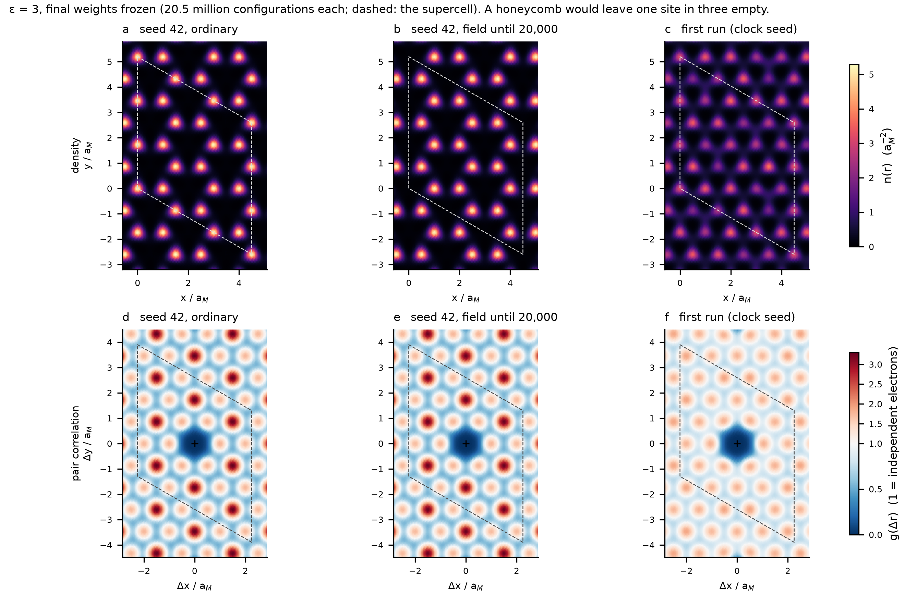

# authors_exact_code_runs/runs/18_electrons_27_sites_eps3_seed42 — eps = 3: a honeycomb test and a second random start

Asked for by Khabab on 2026-11-19. Two runs of the authors' code (`external/PeriodicWave`, commit
`6525d2f3eec53f085b55d485e1bff45d61ef1782`, no file of it changed), their released settings,
18 electrons on 27 sites, eps = 3, the self-attention network (`CustomPsiformer`), both from the
**same initial weights and walkers** (fixed seed 42):

| | GPU 0: honeycomb test (`honeycomb_field/`) | GPU 1: ordinary training (`ordinary/`) |
|---|---|---|
| iterations 0 to 19,999 | their Hamiltonian + a field that empties one sublattice | their Hamiltonian |
| at 19,999 | checkpoint saved; S(kappa) and sublattice shares measured: did a honeycomb form? | |
| iterations 20,000 to 199,999 | their Hamiltonian, the field off, continuing from that checkpoint | their Hamiltonian |
| afterwards | final weights frozen, field off (evaluate_authors_weights.py) | the same |

The questions: does a prepared honeycomb survive once the field is gone, and is its energy (field
off, frozen weights) lower than the liquid-like state? Does ordinary training from another random
start find a honeycomb? Reference: the first eps = 3 run (`../18_electrons_27_sites_eps3_released_settings/`,
clock seed), frozen weights -95.9339(2) meV per electron, S(kappa) 0.666.

What the outcomes can and cannot say: a honeycomb that survives and is reliably LOWER in energy shows
that this network and this Hamiltonian hold a better ordered state that ordinary training missed.
One that survives but is higher is a local minimum. One that melts shows nothing about energies
(the field may have left a poor network, or the optimiser may leave a shallow minimum). One seed.

## What is changed (changes.diff)

- `run_2deg_triangular_potential_seed42.py`: their script with ONE line added,
  `cfg.debug.deterministic = True`. Their train.py then uses the seed 42 instead of a seed taken from
  the clock (train.py lines 368-372). That seed makes the initial weights (`network.init`), the
  initial walkers and every Metropolis move. Used by GPU 1 and by GPU 0 from iteration 20,000.
- `run_2deg_triangular_potential_seed42_field.py`: that copy with three more lines: the Hamiltonian
  named by `cfg.system.make_local_energy_fn` is `honeycomb_field.local_energy`, its strength is 0.5,
  and `cfg.optim.iterations = 20000` (their code saves a checkpoint at the last iteration).
- `honeycomb_field.py` (new): THEIR local energy, built unchanged, plus
  E_field = lambda * sum over electrons of sum_j cos(kappa_j . r), kappa_j the three corners of the
  moire Brillouin zone at 0, 120, 240 degrees. On the 27 sites this is 3 lambda on sublattice 0 and
  -1.5 lambda on the others: sublattice 0 is raised by 4.5 lambda = 7.6 meV (lambda = 0.5 code
  units = 1.69 meV); a full honeycomb gains 2.5 meV per electron from it. The walkers are sampled
  from |Psi|^2 alone; the field acts through the local energy that training lowers.

`test_honeycomb_field.py` checks, before the start: the field's values on the sites and its
periodicity; that the field script's local energy, built as their train.py builds it, is the plain
one plus exactly the field term; that the seed-42 configuration differs from the first eps = 3 run's
`config.json` only in `debug.deterministic`, and the field configuration from the seed-42 one only
in the three field entries; that both start from the same weights.

## How it was started

```bash
cd ~/moire-nnvmc/authors_exact_code_runs/runs/18_electrons_27_sites_eps3_seed42
setsid nohup flock -n ~/moire-nnvmc/runs/gpu_locks/gpu0.lock bash how_this_was_started.sh 0 field >> logs/gpu0.log 2>&1 < /dev/null &
setsid nohup flock -n ~/moire-nnvmc/runs/gpu_locks/gpu1.lock bash how_this_was_started.sh 1 ordinary >> logs/gpu1.log 2>&1 < /dev/null &
```

Output, written by their code, in `ordinary/`, `honeycomb_field/phase1_field_on/` and
`honeycomb_field/phase2_field_off/`, each `results/2deg-CoulombMoire/CustomPsiformer/el18_0_N27_V4.44370908_45.0_U17.70578894/`
(`config.json`, `train_stats.csv`, `qmcjax_ckpt_<step>.npz` every 30 minutes). The phase-1 check is in
`honeycomb_field/phase1_check.csv` and `logs/gpu0.log`. Note: while the field is on, the energies in
phase 1's `train_stats.csv` include the field term.

## Log

- 2026-11-19, before the start: test_honeycomb_field.py, 6 tests, all pass (CPU). Three mutants, all
  caught: the field term removed from local_energy (EnergyTest fails), kappa of half the length
  (FieldTest fails), the seed line removed from the seed script (ConfigTest fails).
  check_honeycomb.py on the final checkpoint of the first eps = 3 self-attention run (1024 walkers):
  S(kappa) 0.712, sublattice shares 0.328 0.332 0.340 (its frozen evaluation: 0.666 and
  0.325 0.332 0.344). The launcher was dry-run with a fake python: phase 1 in phase1_field_on/, the
  checkpoint copied once, phase 2 in phase2_field_off/ finds it; started again, phase 1 is skipped.
- 2026-11-19 05:15:22: both runs started (2 GPUs). GPU 0: `bash how_this_was_started.sh 0 field`;
  GPU 1: `bash how_this_was_started.sh 1 ordinary`.
  config.json against the first eps = 3 self-attention run: the ordinary run differs only in
  debug.deterministic (False -> True); phase 1 in addition only in optim.iterations (20000),
  system.make_local_energy_fn (honeycomb_field.local_energy) and
  system.make_local_energy_kwargs.honeycomb_field_strength (0.5).
  Iteration 0: pmove 0.16832682 in both runs (same seed, same walkers, same weights, same moves);
  energy -312.7813 (field) and -312.667 (ordinary); the difference, -0.114, is the field term of
  those walkers.
  Speed 0.36 s per iteration on each GPU: phase 1 about 2 hours, each run about 20 hours.

- 2026-11-23: frozen evaluation of both final checkpoints, field off (2 GPUs, 01:46 to 03:03).
  evaluate_authors_weights.py extended for these run folders (it finds the seed-42 script above
  them; phase 2's train_stats.csv starts at 20,000, after its copied checkpoint): 14 tests pass, 3
  mutants caught. Results below.

## Results (2026-11-23)

Both runs ended normally (exit code 0; GPU 0, phase 2: 2026-11-20 02:09:50; GPU 1: 2026-11-20
03:10:01), no NaN in any train_stats.csv. Final weights frozen on 2026-11-23, field off
(`code/launch_evaluation_seed42.sh`: `evaluate_authors_weights.py`, 20,480,000 configurations each,
2 GPUs, about 75 minutes). Sanity checks passed: first 200 steps -512.62715 against -512.67719 at the
end of training (field run), -512.61136 against -512.68073 (ordinary). Tables and figure:
`code/seed42_evaluation_results.py` -> `results/frozen_energies.csv`, `frozen_structure.csv`,
`frozen_site_pattern.csv`, `checkpoint_structure.csv`, `figures/frozen_density_pair_correlation.png`.

| eps = 3, self-attention, authors' code, released settings | seed 42, ordinary | seed 42, field until 20,000 | first run (clock seed) |
|---|---|---|---|
| frozen energy (meV per electron) | **-96.1305(2)** | **-96.1335(1)** | -95.9339(2) |
| training, last 20 % (160,000 to 199,999) | -96.1437(1) | -96.1434(1) | -95.9563(2) |
| frozen minus first run | **-0.1967(3)** | **-0.1996(3)** | 0 |
| S(kappa) (connected); a perfect honeycomb 4.5 | 2.649 (0.461) | 2.628 (0.465) | 0.666 (0.663) |
| sublattice shares 0 / 1 / 2 | 0.482 / 0.482 / **0.036** | **0.037** / 0.481 / 0.482 | 0.325 / 0.332 / 0.344 |
| site occupations, lowest to highest | 0.067 to 0.967 | 0.073 to 0.965 | 0.513 to 0.788 |
| site pattern at +-kappa (summed over all 27 q) | 7.149 (7.149) | 7.092 (7.092) | 0.011 (0.261) |
| kinetic / moire / Coulomb (meV per electron) | 26.335 / -29.337 / -93.129 | 25.994 / -29.069 / -93.058 | 22.867 / -25.911 / -92.890 |
| frozen minus training | +0.013 | +0.010 | +0.022 |



Every checkpoint (`results/checkpoint_structure.csv`, the 1024 walkers of each):
- **ordinary** (no field ever): a honeycomb with sublattice 2 empty from the FIRST checkpoint
  (iteration 4,709) to the last: empty-sublattice share 0.031 to 0.040, S(kappa) 2.60 to 2.72, in
  all 44 checkpoints.
- **field run**: phase 1 (field on), sublattice 0 share 0.026 to 0.028 (5 checkpoints; at 19,999:
  0.027, S(kappa) 2.75, `honeycomb_field/phase1_check.csv`); phase 2 (field off, 39 checkpoints to
  199,999), 0.027 to 0.039. It never melted.

What this shows (one seed of each, at eps = 3):
- The authors' code, with their released settings, found the honeycomb Wigner crystal from seed 42
  WITHOUT any field, as early as iteration 4,709. The first run, with the same code and settings
  and only another random start (clock seed), ended in the even, liquid-like state.
- The honeycomb's frozen energy is 0.197 to 0.200 meV per electron BELOW the first run's state,
  about 750 of the combined error bars. The first run had stopped in a higher local minimum:
  this training does not reliably reach the lower state, and which state it reaches depends on
  the random start. (The first author's plot: the crystal about 0.16 meV per electron below the
  liquid near eps = 3.3.)
- The prepared honeycomb survived 180,000 iterations without the field and ends at the same
  state as the spontaneous one: the two are the same honeycomb shifted by one site (a different
  empty sublattice), and their frozen energies differ by 0.0029(2) meV per electron -- two
  separately trained networks for equivalent states, not a physical difference. (The ordinary
  run's two evaluation halves differ by 2.2 combined error bars, so its error bar may be slightly
  small.)
- Not shown: how often a random start finds the honeycomb (here 1 of 2 starts at eps = 3), nor
  anything at eps = 5, where the first author puts the crystal and the liquid nearly level.
