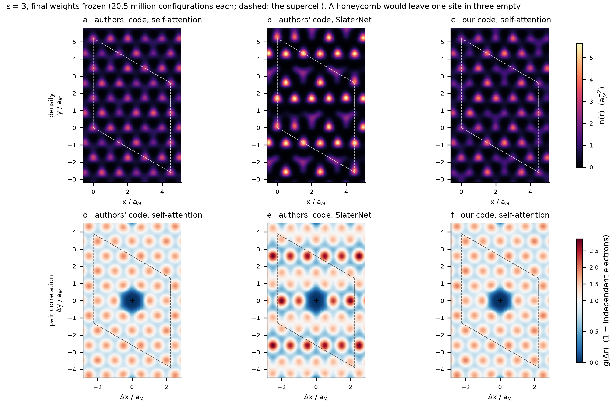

# authors_exact_code_runs/runs/18_electrons_27_sites_eps3_released_settings — the authors' code, unchanged, at eps = 3

**What this is.** Asked for by Khabab's professor on 2026-11-17: the authors' released program
(`external/PeriodicWave`, their published commit `6525d2f3eec53f085b55d485e1bff45d61ef1782`, no
file of it changed) run exactly as they publish it, for 18 electrons on 27 sites at **eps = 3**,
with **both networks**: the self-attention network (`CustomPsiformer`) and `SlaterNet`.

**No line of ours is in the training.** It is started with their script, their settings and their
arguments (spins, sites, m*/m_e, 1/eps, a_M in nm, V in meV, phi in degrees, network):

```bash
python external/PeriodicWave/periodicwave/configs/run_2deg_triangular_potential.py 18_0 27 0.35 0.3333333333333333 8.031 15 45 CustomPsiformer
python external/PeriodicWave/periodicwave/configs/run_2deg_triangular_potential.py 18_0 27 0.35 0.3333333333333333 8.031 15 45 SlaterNet
```

`0.3333333333333333` is 1/eps = 1/3 (their script reads it with `float()`; this is the number
nearest to 1/3 a computer can store). The interaction strength becomes U = 17.70578894 (code
units), against 10.62347336 at eps = 5 and 5.31173668 at eps = 10.

The released settings, as their script sets them (nothing changed):

| | self-attention (`CustomPsiformer`) | `SlaterNet` |
|---|---|---|
| walkers | 1024 | 1024 |
| iterations | 200,000 | 200,000 |
| learning rate | 0.1 / (1 + t/20,000) | 0.1 / (1 + t/20,000) |
| network | 4 layers, 4 heads, 2 perceptrons per layer, layer norm | 4 layers, 2 perceptrons per layer, layer norm |
| determinants | 4 | 1 (their script: "equivalent to Hartree-Fock") |

Why eps = 3. The paper's first author wrote on 2026-11-16 that eps = 5 lies very close to a
first-order transition (at eps about 4.9) between the Wigner crystal and the Fermi liquid, both
local minima there; at eps about 3.3 his plot has the crystal about 0.16 meV per electron below the
liquid. At eps = 3 the crystal should therefore be the clearly lower state. (Our own code at
eps = 3, `runs/stage08/18_electrons_27_sites_eps3_real_gradient/`, gave no honeycomb.)

## How it was started

`how_this_was_started.sh GPU NETWORK` (this folder), as for the other authors'-code runs: one GPU
made visible, the output kept in `logs/`, two passive monitors every 10 s (GPU: `logs/gpuG_monitor_*.csv`;
CPU and memory: `logs/gpuG_system_*.csv`) and a check before the run that the GPU can start a program.

```bash
cd ~/moire-nnvmc/authors_exact_code_runs/runs/18_electrons_27_sites_eps3_released_settings
setsid nohup flock -n ~/moire-nnvmc/runs/gpu_locks/gpu0.lock bash how_this_was_started.sh 0 CustomPsiformer >> logs/gpu0.log 2>&1 < /dev/null &
setsid nohup flock -n ~/moire-nnvmc/runs/gpu_locks/gpu1.lock bash how_this_was_started.sh 1 SlaterNet >> logs/gpu1.log 2>&1 < /dev/null &
```

Started again with the same command, their code continues from its newest checkpoint (every 30 minutes).

Output, written by THEIR code:
`results/2deg-CoulombMoire/CustomPsiformer/el18_0_N27_V4.44370908_45.0_U17.70578894/` and
`results/2deg-CoulombMoire/SlaterNet/el18_0_N27_V4.44370908_45.0_U17.70578894/`, each with
`config.json`, `train_stats.csv` (`energy` x 3.375559 / 18 = meV per electron) and
`qmcjax_ckpt_<step>.npz` (checkpoints: weights and walkers).

## Log

**2026-11-17, 02:09:36: both started**, self-attention on GPU 0, SlaterNet on GPU 1 (250 W cap).
The `config.json` their code wrote: 1024 walkers, 200,000 iterations, learning rate 0.1, interaction
strength 17.70578894 (eps = 3); SlaterNet with 1 determinant, self-attention with 4.
Speed in the first hour: self-attention 0.383 s per iteration (200,000: about 21 hours, end about
2026-11-17 23:30 UTC), SlaterNet 0.191 s per iteration (about 10.6 hours, end about 12:45 UTC).

**2026-11-17, about 02:30 to 03:12: the server could not be reached from outside** (network only:
the runs went on; uptime since 2026-11-11, no GPU fault in the kernel log).

**2026-11-17: both finished**, without a GPU fault: SlaterNet at 13:16:48, self-attention at
23:23:49 (step 199,999 each; exit code 0; no non-finite row). The server's network link dropped
twice while they ran (2026-11-17 02:30 to 03:12, 2026-11-19 about 02:25); the runs were not affected.

## Results

Made by `../../code/eps3_checkpoint_structure.py` (2026-11-19), which calls the functions of
`learn/stage08_own_code/analysis/18_electrons_27_sites/authors_code_results.py`, unchanged: the
training energy over the last 20 % of the iterations (40,000 rows) with a blocking error, and
`checkpoint_structure.measure` on the walkers of every checkpoint their code saved. Numbers in
`analysis/summary.csv`, `analysis/checkpoint_structure_CustomPsiformer.csv`,
`analysis/checkpoint_structure_SlaterNet.csv`. These are TRAINING averages and the walkers of the
checkpoints; the frozen-weight evaluation follows.

| eps = 3, authors' code, released settings | self-attention | SlaterNet |
|---|---|---|
| energy, meV per electron (training, last 20 %) | -95.9563(2) | -94.2734(8) |
| S(kappa); a honeycomb gives 4.5 | 0.680 (9,216 walkers of the last 20 %); 0.59 to 0.71 over 43 checkpoints | 0.553 (6,144 walkers); 0.53 to 0.57 over 23 checkpoints |
| sublattice shares; a honeycomb gives 0, 1/2, 1/2 | 0.329, 0.331, 0.340 | 0.348, 0.346, 0.306 |

- **No honeycomb at eps = 3 either**, with the authors' own code and their released settings, for
  both networks, at any checkpoint.
- The self-attention network is 1.68 meV per electron below SlaterNet.
- SlaterNet (one determinant) leaves one sublattice slightly emptier (0.306 against 1/3); a
  honeycomb would empty it completely.
- The paper has no eps = 3 value. The first author's plot (e-mail of 2026-11-16) puts the Wigner
  crystal about 0.16 meV per electron below the Fermi liquid at eps about 3.3, so at eps = 3 the
  crystal should be the lower state; these runs did not find it.
- One run per network, each with the authors' random start.

### Final weights frozen (2026-11-19)

`../../code/evaluate_authors_weights.py --inverse-eps 1/3 --network CustomPsiformer | SlaterNet`
(`../../code/launch_evaluation_eps3.sh`, both GPUs, 02:55 to 04:07 UTC): the authors' network,
sampler and local energy with the final weights held fixed, 20,480,000 configurations each; both
passed the check against the end of training. Output in `evaluation/<parameters>/` (self-attention)
and `evaluation/SlaterNet_<parameters>/`. Tables and figure made by
`../../code/eps3_evaluation_results.py` with learn's functions, unchanged, next to our own code's
self-attention run at eps = 3 (`runs/stage08/18_electrons_27_sites_eps3_real_gradient/`: Table II
settings, the authors' gradient): `results/frozen_energies.csv`, `results/frozen_structure.csv`,
`results/frozen_site_pattern.csv`, `figures/frozen_density_pair_correlation.png`.

| eps = 3, final weights frozen | authors' code, self-attention | authors' code, SlaterNet | our code, self-attention |
|---|---|---|---|
| energy, meV per electron | -95.9339(2) | -94.2526(11) | -95.8838(2) |
| training average (last 20 %) | -95.9563(2) | -94.2734(8) | -95.9056(2) |
| S(kappa); a honeycomb gives 4.5 | 0.666 | 0.551 | 0.631 |
| sublattice shares; a honeycomb gives 0, 1/2, 1/2 | 0.325, 0.332, 0.344 | 0.352, 0.342, 0.306 | 0.329, 0.343, 0.328 |
| site occupations, smallest to largest (even: 0.667) | 0.51 to 0.79 | 0.25 to 0.98 | 0.43 to 0.87 |
| site pattern, summed over its 27 wave vectors | 0.26 | 3.58 | 0.88 |
| ... of which at +-kappa (a honeycomb: 9) | 0.01 | 0.06 | 0.01 |
| ... of which at the six with |q| = 2.418 | 0.09 | 2.40 (1.18 at each of +-(0, 1/3) b) | 0.22 |



- **No honeycomb in any of the three.**
- **SlaterNet (one determinant) forms a stripe pattern**: rows of nearly full sites (up to 0.98)
  and, one row in three, nearly empty sites (down to 0.25) with some density between the sites.
  Its site pattern sits almost entirely at one pair of wave vectors, +-(0, 1/3) in units of the
  moire reciprocal vectors (|q| = 2.418), one direction only. It is 1.68 meV per electron above the
  self-attention network.
- The authors' self-attention network with the released settings is 0.050 meV per electron below
  ours with the Table II settings (frozen weights, both), with a less uneven density (0.51 to 0.79
  against 0.43 to 0.87).
- Frozen weights lie 0.021 to 0.022 meV per electron above the training averages, in all three.
