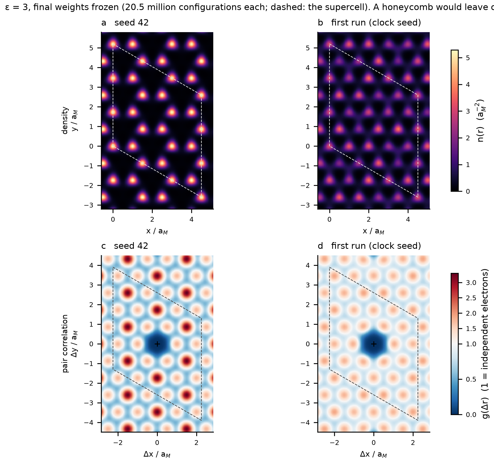

# authors_exact_code_runs/runs/18_electrons_27_sites_eps3_seed42 — eps = 3: the authors' code from seed 42

Asked for by Khabab on 2026-11-19. One run of the authors' code (`external/PeriodicWave`, commit
`6525d2f3eec53f085b55d485e1bff45d61ef1782`, no file of it changed), their released settings,
18 electrons on 27 sites, eps = 3, the self-attention network (`CustomPsiformer`), with a **fixed
random seed, 42**, instead of one taken from the clock. Everything else is as in the first eps = 3
run (`../18_electrons_27_sites_eps3_released_settings/`, clock seed): the question was whether
another random start ends in another state.

Until 2026-11-23 this folder also held a second run from the same seed, with a field that emptied
one sublattice during the first 20,000 iterations (the "honeycomb-field test", GPU 0). At Khabab's
request it was moved, with its code, logs and evaluation, to
`../../archive/eps3_seed42_honeycomb_field/` (README there). In one line: the honeycomb it prepared
survived without the field and ended where this run ended by itself.

## What is changed (changes.diff)

`run_2deg_triangular_potential_seed42.py`: their script with ONE line added,
`cfg.debug.deterministic = True`. Their train.py then uses the seed 42 instead of a seed taken from
the clock (train.py lines 368-372). That seed makes the initial weights (`network.init`), the
initial walkers and every Metropolis move.

`check_honeycomb.py`: S(kappa) and the three sublattice shares of the walkers in one checkpoint
(learn's functions, unchanged).

## How it was started

```bash
cd ~/moire-nnvmc/authors_exact_code_runs/runs/18_electrons_27_sites_eps3_seed42
setsid nohup flock -n ~/moire-nnvmc/runs/gpu_locks/gpu1.lock bash how_this_was_started.sh 1 >> logs/gpu1.log 2>&1 < /dev/null &
```

(On 2026-11-19 the earlier version of the script was used, `bash how_this_was_started.sh 1 ordinary`;
the present one runs the same commands; see its top.) Output, written by their code, in
`ordinary/results/2deg-CoulombMoire/CustomPsiformer/el18_0_N27_V4.44370908_45.0_U17.70578894/`
(`config.json`, `train_stats.csv`, `qmcjax_ckpt_<step>.npz` every 30 minutes); the frozen-weight
evaluation in `ordinary/evaluation/el18_0_N27_V4.44370908_45.0_U17.70578894/`.

## Log

- 2026-11-19, before the start: the seed-42 script was checked (in `test_honeycomb_field.py`, now
  in the archive): its configuration differs from the first eps = 3 run's `config.json` only in
  `debug.deterministic`; a mutant without the seed line was caught.
- 2026-11-19 05:15:22: started on GPU 1. Its `config.json` against the first eps = 3 run: only
  `debug.deterministic` (False -> True). Iteration 0: pmove 0.16832682. 0.36 s per iteration.
- 2026-11-20 03:10:01: ended, exit code 0, 200,000 iterations, no NaN, 44 checkpoints.
- 2026-11-23: frozen evaluation of the final checkpoint on GPU 1 (01:46 to 03:03;
  `code/launch_evaluation_seed42.sh`, `evaluate_authors_weights.py`, 20,480,000 configurations;
  sanity check passed: first 200 steps -512.61136, end of training -512.68073).
  `evaluate_authors_weights.py` was extended for this folder (it finds the seed-42 script one folder
  above the run folder); its tests pass and the mutants are caught (see the commits).
- 2026-11-23: the honeycomb-field test moved to the archive (above); `results/` and `figures/` made
  again without it (`code/seed42_evaluation_results.py`); the numbers of this run are unchanged.

## Results (2026-11-23)

Tables and figure: `code/seed42_evaluation_results.py` -> `results/frozen_energies.csv`,
`frozen_structure.csv`, `frozen_site_pattern.csv`, `checkpoint_structure.csv`,
`figures/frozen_density_pair_correlation.png`.

| eps = 3, self-attention, authors' code, released settings | seed 42 | first run (clock seed) |
|---|---|---|
| frozen energy (meV per electron) | **-96.1305(2)** | -95.9339(2) |
| training, last 20 % (160,000 to 199,999) | -96.1437(1) | -95.9563(2) |
| frozen minus first run | **-0.1967(3)** | 0 |
| S(kappa) (connected); a perfect honeycomb 4.5 | 2.649 (0.461) | 0.666 (0.663) |
| sublattice shares 0 / 1 / 2 | 0.482 / 0.482 / **0.036** | 0.325 / 0.332 / 0.344 |
| site occupations, lowest to highest | 0.067 to 0.967 | 0.513 to 0.788 |
| site pattern at +-kappa (summed over all 27 q) | 7.149 (7.149) | 0.011 (0.261) |
| kinetic / moire / Coulomb (meV per electron) | 26.335 / -29.337 / -93.129 | 22.867 / -25.911 / -92.890 |
| frozen minus training | +0.013 | +0.022 |



Every checkpoint (`results/checkpoint_structure.csv`, the 1024 walkers of each): a honeycomb with
sublattice 2 empty from the FIRST checkpoint (iteration 4,709) to the last: empty-sublattice share
0.031 to 0.040, S(kappa) 2.60 to 2.72, in all 44 checkpoints.

What this shows (one run from each start, at eps = 3):
- The authors' code, with their released settings, found the honeycomb Wigner crystal from seed 42,
  as early as iteration 4,709, without any help. The first run, with the same code and settings and
  only another random start (clock seed), ended in the even, liquid-like state.
- The honeycomb's frozen energy is 0.197 meV per electron BELOW the first run's state, about 750
  of the combined error bars. The first run had stopped in a higher local minimum: this training
  does not reliably reach the lower state, and which state it reaches depends on the random start.
  (The first author's plot: the crystal about 0.16 meV per electron below the liquid near
  eps = 3.3.)
- The run's two evaluation halves differ by 2.2 combined error bars, so its error bar may be
  slightly small.
- Not shown: how often a random start finds the honeycomb (1 of 2 starts of the authors' code at
  eps = 3), nor anything at eps = 5, where the first author puts the crystal and the liquid nearly
  level. Our own code from two random starts at eps = 3, the same settings:
  `runs/stage08/18_electrons_27_sites_eps3_released_seeds/` (started 2026-11-23).
