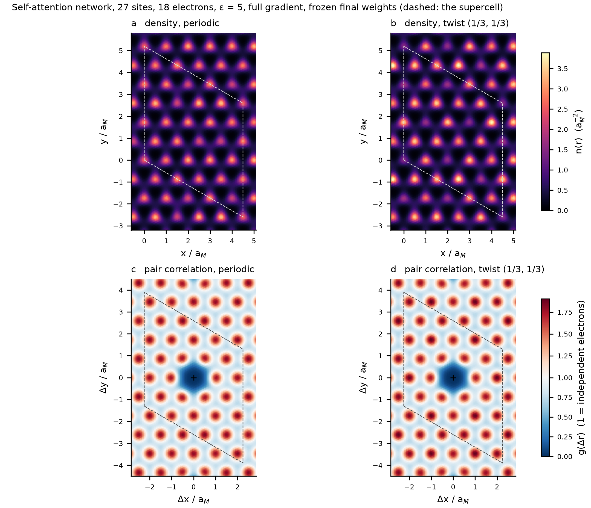
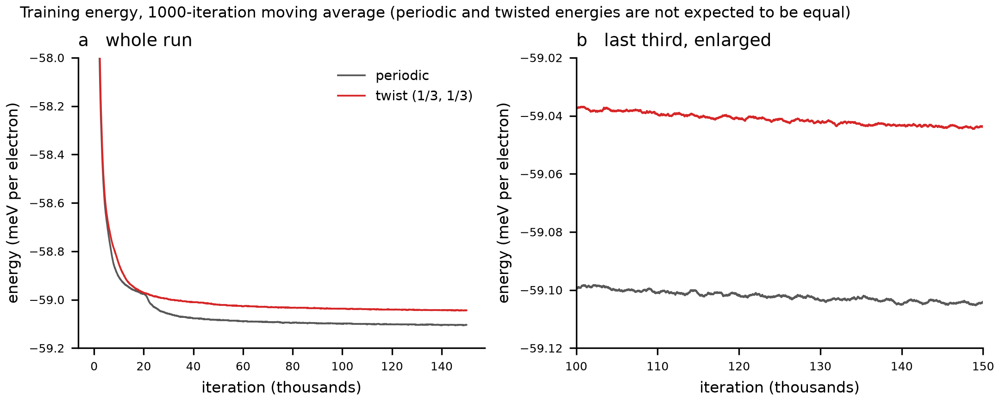

# Paradox experiment: twisted boundary conditions

Started 2026-11-14.  Everything about this experiment is in this folder.  Nothing in `learn/` was
changed: the two files that had to change were **copied** here and changed here, and
`CHANGES.diff` shows every changed line.

## The paradox

The paper's Fig. 6 shows, at eps = 5, a honeycomb crystal (18 electrons on 27 sites: two of
every three sites filled).  No run of ours shows it, and neither do the reference runs with the
authors' own code (`authors_exact_code_runs/`).  The energies agree
with the paper to a few hundredths of a meV; the pattern does not.

Our diagnosis so far (`shell_structure.py`, the open-shell report): in the 27-site supercell with
**periodic** boundary conditions, 18 electrons without interaction do not have a unique lowest
state.  The last 5 electrons go into a shell of 6 levels of equal energy -- an **open shell**.
At eps = 5 and 10 the trained networks keep 96-98 % of their weight on the six total momenta of
that open shell.

## The idea tested here

Change the boundary condition so that the shell is **closed**, and see what the same network,
trained the same way, does then.  A twisted boundary condition means: when one electron goes
once around the supercell along L1 or L2, the wave function comes back multiplied by a phase,

    Psi(..., r_j + L_i, ...) = exp(2 pi i T_i) Psi(..., r_j, ...)        (periodic: T_1 = T_2 = 0)

This shifts every allowed one-electron momentum from k to k + k_twist, k_twist = T_1 G_1 + T_2 G_2.
With T = (1/3, 1/3) the 18 lowest levels are 3 + 3 + 6 + 6, separated from the 19th by a gap of
1.126 meV (`code/twist_shells.py`; periodic: gap 0, shells 1 + 6 + 6 + 5 of 6).  The only twists
that keep the momentum grid three-fold symmetric are (0, 0), (1/3, 1/3) and (2/3, 2/3); the last
two are mirror images of each other (k -> -k) and have the same levels.

In the code the twist is one line: the network's periodic wave function is multiplied by
exp(i k_twist . (r_1 + ... + r_N)).  Only the **phase** changes.  The sampling uses |Psi|^2 and
does not see it; the kinetic energy differentiates the phase and does.

Two things to keep in mind:
- The shifted momentum grid is no longer symmetric under k -> -k.  A twisted wave function
  cannot be real, so this run uses `--gradient full` (the imaginary part of the local energy
  kept), and its baseline is the periodic **full-gradient** run.
- "Closed shell" is a statement about electrons **without** interaction.  The gap is 1.1 meV; the
  repulsion between neighbouring sites is about 36 meV at eps = 5.  Whether the gap matters for
  the interacting state is what the run tests.

## What is in this folder

    README.md              this file
    CHANGES.diff           every changed line of the two copied files, against learn/ at commit b6f773f
    code/
      train_moire.py       COPY of learn/stage08_own_code/train_moire.py + the option --twist T1 T2
      evaluate_weights.py  COPY of learn/stage08_own_code/analysis/evaluate_weights.py; only its
                           import path changed, so that it uses the train_moire.py above
      twist_shells.py      new: the one-electron levels with and without a twist (numpy only)
      test_twist.py        new: the checks (below)
      twist_mutants.py     new: plants mistakes to see whether the checks notice them
      twist_results.py     new: the result (calls learn's analysis functions, unchanged)
      launch_twisted.sh    new: starts the run
    results/one_electron_levels.csv     written by twist_shells.py
    results/energies.csv, structure.csv, site_pattern.csv, momentum_weights.csv    written by twist_results.py
    figures/1_density_pair_correlation.png, 2_training_energy.png                  written by twist_results.py
    runs/18_electrons_27_sites_twist_one_third_full_gradient/
      training/attention_18e_eps5/      settings.json, train_stats.csv, checkpoints, starts.log
      training/logs/                    gpu0.log, GPU and CPU/memory monitors (every 10 s), watch.log
      evaluation/attention_18e_eps5/    the final weights, frozen: energies.csv, observables.npz, summary.json

Used **unchanged, from `learn/`** (not copied): Stages 3-7 (wave function, sampling, local
energy, gradient, Ewald sum), `observables.py`, `system_monitor.py`, `watch_run.py`.

What `CHANGES.diff` contains, in words.  `train_moire.py`: two settings (`twist_1`, `twist_2`,
default 0), two small functions (`twist_vector`, `add_twist`), three lines in `make_problem`
that apply the twist when it is not zero, the command-line option, and one line so that folders
made by the original code count as periodic.  `evaluate_weights.py`: the two import-path lines.
The rest is explanation text.

## The run

    cd ~/moire-nnvmc/paradox_solution_twisted_boundaries/code
    bash launch_twisted.sh            # GPU 0 only; about 44 hours of training + 1.3 hours of evaluation
    bash launch_twisted.sh watch      # the watchdog, once train_stats.csv exists

which runs

    train_moire.py --electrons 18 --settings table2 --laplacian folx --determinants slogdet \
        --network attention --eps 5 --gradient full --twist 1/3 1/3

That is the paper's Table II (4096 walkers, 150,000 iterations, learning rate 10 / (1 + t/100000),
3 layers, 6 heads, 4 determinants), the released network form, seed 0.  **Everything except the
twist is identical to the baseline**
`runs/stage08/18_electrons_27_sites_full_gradient/training/attention_18e_eps5`
(`test_twist.py` compares the stored settings entry by entry).

Baseline results (periodic, full gradient, frozen weights): energy -59.0878(2) meV per electron;
S(kappa) = 0.722 (a perfect honeycomb gives 4.5); weight on the six open-shell total momenta
0.983(13).

## Checks before the run

`cd code && ../../.venv/bin/python test_twist.py` -- 18 tests, CPU, about 3 minutes, all pass:

- k_twist . L_i = 2 pi T_i;
- moving **any** one electron by L_1 or L_2 leaves |Psi| unchanged and multiplies Psi by
  exp(2 pi i T_i): attention network at 6 and at 18 electrons, SlaterNet, several twists;
- without a twist the copy **is** the original: log Psi and the local energy are identical
  number for number, and a small training run writes the same checkpoint and train_stats.csv;
- an exact answer: a determinant of plane waves with the twist has kinetic energy
  1/2 sum |k_j + k_twist|^2 at every configuration, through both of Stage 4's routes;
- on the network: twisted minus periodic local energy equals
  1/2 N |k|^2 + k . sum grad(phase) - i k . sum grad(log|Psi|), and log|Psi| is unchanged;
- the launcher's exact command line stores the twist; another twist in the same folder is
  refused; the evaluation copy imports this folder's trainer and gives the run its twist;
- `twist_shells.py` agrees with learn's `shell_structure.py`.

Do the tests notice mistakes?  `../../.venv/bin/python twist_mutants.py` plants 12 mistakes, one
at a time, in a copy of `code/` and runs the tests on each (about 15 minutes).  All 12 were
noticed: the sign of the phase; the twist on one electron only; G_1 and G_2 swapped; the twist
never applied; applied only if both twists are non-zero; the command line dropping the twist;
the command line swapping T1 and T2; old folders not counted as periodic; the evaluation
importing learn's trainer (which knows no twist); the launcher without `--twist`; the launcher
with `--gradient real`; a wrong constant in `twist_shells.py`.

Smoke test on GPU 0 (30 iterations with the launcher's options, then a short evaluation, in
/tmp): both ended with exit code 0; 0.76 s per iteration and 18.4 GB, as the baseline at its start.
At step 0 the acceptance equals the baseline's to all digits (0.1625976711511612: the same
walkers, as it must be), and the energy is higher by 5.37 code units (baseline -150.491,
twisted -145.121).  Expected: 1/2 N |k_twist|^2 = 5.85 plus the walkers' mean of
k . sum grad(phase), whose value is not known beforehand; the test above checks that formula
configuration by configuration.

## Predictions, written down before the run (2026-11-14)

What will be measured on the final weights, with the same functions as for the baseline: the
energy, S(kappa), the 27 site occupations, the three sublattice shares, and the weight of the
state on each total momentum.

1. **If the network follows the closed shell:** nearly all weight on ONE total momentum
   (K = 0, the momentum of the 18 filled levels; the baseline has its weight spread over six),
   all 27 site occupations equal to 2/3 within the noise, S(kappa) below 1 as in the baseline.
   No honeycomb, and no uneven site pattern either.
2. **If a honeycomb crystal forms (the paper's Fig. 6):** S(kappa) well above 1 (4.5 if perfect);
   sublattice shares near 0, 1/2, 1/2 if the pattern stays in place, or even shares with a
   large S(kappa) if it moves; weight on three total momenta K0, K0 + kappa, K0 - kappa.
3. **If nothing changes:** uneven site occupations as in the periodic runs and weight on
   several total momenta.  Then the open shell of the non-interacting electrons was not the reason.

What the result can and cannot say:
- The twisted energy is NOT comparable with the paper's Table I, which is periodic.  Without
  interaction the twist alone raises the energy by 0.047 meV per electron (-6.0338 against
  -6.0809).  How much the interacting energy changes with the twist is itself a result: a
  crystal that is pinned to the lattice should barely notice the boundary condition, a liquid
  notices it.
- Outcome 1 would support the open-shell diagnosis of OUR runs.  It would not explain why the
  paper shows a honeycomb.
- One run, one seed.

## Results (2026-11-16)

The run finished without incident: training 2026-11-14 05:56 to 2026-11-15 15:52 (34 hours,
0.84 s per iteration, no non-finite number, no GPU fault), frozen-weight evaluation until 16:55
(5,000 steps x 4,096 walkers = 20,480,000 configurations; sanity check passed). Numbers made by
`code/twist_results.py`, with learn's functions and the same settings for both runs; it checks
that the two runs differ in the twist and in nothing else.

| eps = 5, full gradient, frozen final weights | periodic (baseline) | twist (1/3, 1/3) |
|---|---|---|
| energy, meV per electron | -59.0878(2) | -59.0224(2) |
| kinetic / moire / Coulomb | 21.307 / -25.695 / -54.700 | 21.519 / -25.860 / -54.681 |
| energy, mean of the last 20 % of training | -59.1033(1) | -59.0427(1) |
| S(kappa); a honeycomb gives 4.5 | 0.722 | 0.631 |
| sublattice shares; a honeycomb gives 0, 1/2, 1/2 | 0.334, 0.328, 0.338 | 0.324, 0.346, 0.330 |
| site occupations, smallest to largest (even: 0.667) | 0.554 to 0.749 | 0.412 to 0.825 |
| site pattern, summed over its 27 wave vectors | 0.121 | 0.732 |
| ... of which at +-kappa (the honeycomb's) | 0.003 | 0.013 |
| ... of which at the six wave vectors with |q| = 3.694 | 0.013 | 0.691 |
| weight at total momentum K = 0 | 0.000(1) | 0.218(5) |
| weight on the six momenta with |K| = 2.793 (the periodic open shell) | 0.983(13) | 0.019(2) |
| weight on the six momenta with |K| = 3.694 | 0.007(1) | 0.622(9) |
| weight on the six momenta with |K| = 2.418 | 0.003(1) | 0.113(4) |

Against the three predictions:

1. **The network did not follow the closed shell.** Only 22 % of its weight is at K = 0; the
   site occupations are MORE uneven than in the periodic run (0.41 to 0.83 against 0.55 to 0.75).
2. **No honeycomb.** S(kappa) went down, not up (0.63), and the site pattern at +-kappa is 0.013
   where a honeycomb has 9.
3. The outcome is closest to the third one -- uneven sites, weight on several total momenta --
   but it is not "nothing changed": the weight moved to other momenta and the pattern to other
   wave vectors.

What the new momenta are. Lifting ONE electron of the closed shell from the highest filled level
(6 levels at -2.124 meV) into the lowest empty one (3 levels at -0.998 meV) costs 1.126 meV for
the whole system, 0.063 meV per electron. `twist_shells.py`'s levels give these excitations
total momenta with |K| = 1.396, 2.418 or 3.694, six of each. The trained state has 22 % at K = 0
and 76 % on those three groups (62 % on the six momenta with |K| = 3.694). And the uneven site pattern sits at the six wave vectors |q| = 3.694, which are
the differences between K = 0 and those six momenta -- as it must: a density wave at q needs
weight on two total momenta that differ by q. So the state is consistent with a mixture of the
closed shell and its cheapest excitations. The weights say which total momenta, not which
arrangements of electrons; this reading is consistent with the numbers, not shown by them.

What this means for the paradox:

- **The twist does not bring the honeycomb.** Closing the shell of the non-interacting electrons
  is not what was missing.
- **It does not make the state even or single-momentum either.** The mixing of several total
  momenta is therefore not special to the periodic open shell. The warning written before the
  run applies: the gap of 1.1 meV is small against the repulsion, and the network mixes across it.
  The open-shell diagnosis still describes WHERE the periodic runs keep their weight (98 % in
  that shell); it does not explain WHY a trained network ends in a mixture.
- The energy with the twist is 0.065 meV per electron higher than periodic (without interaction
  the twist alone costs 0.047). The two are different boundary conditions; neither number can
  be compared with the other as better or worse, and the twisted one cannot be compared with
  the paper's Table I.
- The Hamiltonian does not mix different total momenta, so the energy of a mixture is the
  weighted average of the energies of its parts, and the best part alone would be at least as
  low. A mixture therefore means either that several momenta have almost the same lowest energy
  or that the optimisation has not finished choosing. This run cannot tell which. Both training
  curves were still falling slowly at the end (about 0.005 to 0.007 meV per electron over the
  last 50,000 iterations).
- One run, one seed.
