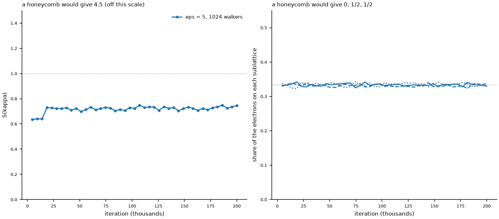

# runs/stage08/18_electrons_27_sites_authors_code — the authors' own code, unchanged, as a reference

**What this is.** The authors' released program (`external/PeriodicWave`, their published commit
`6525d2f3eec53f085b55d485e1bff45d61ef1782`, no file of it changed; checked with `git status`
before the start) run exactly as they publish it, for the system of the paper's Table I and
Fig. 6: 18 electrons on 27 sites, the self-attention network, eps = 5 and eps = 10.

**No line of ours is in the training.** It is started with their script and their arguments
(spins, sites, m*/m_e, 1/eps, a_M in nm, V in meV, phi in degrees, network):

```bash
python external/PeriodicWave/periodicwave/configs/run_2deg_triangular_potential.py 18_0 27 0.35 0.2 8.031 15 45 CustomPsiformer   # eps = 5
python external/PeriodicWave/periodicwave/configs/run_2deg_triangular_potential.py 18_0 27 0.35 0.1 8.031 15 45 CustomPsiformer   # eps = 10
```

No wrapper (`run_moire.py` is not used), no changed setting, their own random seed (from the
clock, so a repeat would not give the same numbers). `how_this_was_started.sh` is everything
around it: one GPU made visible, the output kept in `logs/`, the lock of our own tools on that
GPU held with `flock`, two passive monitors every 10 s (`nvidia-smi`, `system_monitor.py`), and
(since the second version) a check before each run that the GPU can start a program at all.

**The settings are therefore those of their script**, as its own `config.json` in each run
folder records. They are not the paper's Table II:

| | their script (these runs) | paper's Table II (our own-code runs) |
|---|---|---|
| walkers | 1024 | 4096 |
| learning rate | 0.1 / (1 + t/20000) | 10 / (1 + t/100000) |
| iterations | 200,000 | 150,000 |
| attention network | 4 layers, 4 heads, 2 perceptrons per layer | 3 layers, 6 heads, 1 perceptron per layer |
| the same in both | GELU and layer norm, attention dimension 16, width 64, 4 determinants, clipping 5, KFAC norm constraint and damping 1e-3, 30 Metropolis steps, folx | |

Their README says the script's defaults "are set to reproduce results from Fig. 5" (6 electrons
on 9 sites). The script has no option for the entries above; using Table II's values would mean
changing six numbers in their file.

**First start, 2026-11-10 02:14:38 server time, GPU 1: lost after 11 minutes.** At 02:25:35 GPU 1
fell off the bus (kernel log: `Xid 79, GPU has fallen off the bus`, then `Xid 154 ... Node Reboot
Required` for both GPUs), at 82-85 C and about 270 W, with both GPUs loaded. It is the second
time (first: 2026-10-28, also GPU 1). The eps = 5 run died at about step 1,400 (0.344 s per
iteration until then; energy -307.6 code units = -57.7 meV per electron at step 1,405, far from
converged), and the eps = 10 run that followed began on the CPU without a word: the authors'
code has no check for that. Both were stopped by hand at 02:38; what they had written is in
`lost_gpu_2026-11-10/` (no checkpoint: the first one is written after 30 minutes). Since the
fault, no new program can start on either GPU until the server is rebooted (the driver's
`cuInit` fails on both); the run that was already on GPU 0 goes on.

**Not running. To start again after a reboot** (about 19 hours per run at 0.344 s per iteration;
G = the GPU, 0 or 1):

```bash
cd ~/moire-nnvmc/runs/stage08/18_electrons_27_sites_authors_code
setsid nohup flock -n ~/moire-nnvmc/runs/gpu_locks/gpuG.lock bash how_this_was_started.sh G >> logs/gpuG.log 2>&1 < /dev/null &
```

The start script now refuses, and stops its queue, when the GPU cannot start a program
(checked 2026-11-10: on the faulted machine it starts nothing; in a dry run it gives the two
commands above; with the GPU lost after the first run it stops before the second).

**Where the results are.** Their script names its folders after the parameters:
- eps = 5: `results/2deg-CoulombMoire/CustomPsiformer/el18_0_N27_V4.44370908_45.0_U10.62347336/`
- eps = 10: `results/2deg-CoulombMoire/CustomPsiformer/el18_0_N27_V4.44370908_45.0_U5.31173668/`
  (the last number is the Coulomb strength in code units; the folder appears when that run starts)

In each: `config.json` (every setting), `train_stats.csv` (step, energy, ewmean, ewvar, pmove,
locstd; `energy` is for the whole system in code units, x 3.375559 / 18 gives meV per electron;
the file is written in blocks, so it lags by up to about 150 steps), `qmcjax_ckpt_<step>.npz`
(a checkpoint every 30 minutes: weights and the 1024 walkers), `device_info.log`.

Watch:  `tail -f runs/stage08/18_electrons_27_sites_authors_code/logs/gpuG.log`

**Afterwards** (analysis only; the runs stay theirs): the energy of the last 20 % of the
iterations against Table I, and S(kappa), the sublattices and the density from the walkers in
the checkpoints -- is there a honeycomb at eps = 5?

**2026-11-11, 03:14: started again, on GPU 1** (the same command with G = 1), eps = 5 and then
eps = 10. Before that: `sudo reboot` on 2026-11-10 06:30 did not bring the server back (as on
2026-10-29, the other time GPU 1 had fallen off the bus); it was switched off and on by hand on
2026-11-11 02:36, and both GPUs then passed the check. `config.json` of the new run was
compared with the Table II run's: they differ only in the seven Table II values, the
interaction strength and the output path.

**2026-11-11, 03:21:00: GPU 1 fell off the bus again, 7 minutes after the start** (kernel log:
Xid 79 on PCI 0000:65:00, then Xid 154 "Node Reboot Required" on both GPUs). The eps = 5 run
had reached step 727 (energy -291.3 code units; no checkpoint yet); the start script saw that
the GPU could not start a program and did not begin eps = 10. The partial output is in
`lost_gpu_2026-11-11/`. Last lines of `logs/gpu1_monitor_2026-11-11_031400.csv` before the
loss: 100 % load, 85-87 C, 262-273 W, with the thermal-slowdown or power-cap flag set.
GPU 1 has now been lost three times: 2026-10-28 (after about 190,000 iterations of a 6-electron
run), 2026-11-10 (11 minutes into this run) and 2026-11-11 (7 minutes). Nothing new can start
on either GPU until the server is switched off and on.

**2026-11-11, 04:03: started again on GPU 1, now capped at 250 W** (`sudo nvidia-smi -i 1 -pl 250`,
typed by Khabab; the cap is gone after every boot). The server had been restarted at 03:52 with
`sync; sudo ipmitool chassis power cycle`, which cuts the power and came back by itself in
about a minute -- unlike `sudo reboot`, which twice did not come back after this fault.
With the cap GPU 1 runs at about 235 W and 70-75 C (before: about 275 W, 83-87 C) and one
iteration takes about 0.37 s (before: 0.34 s), so about 21 hours for each eps. It passed the
points of the two earlier losses (7 and 11 minutes) without a fault; that is one observation,
not proof that the cap is the cure.

**2026-11-12, 01:34: eps = 5 finished** (step 199,999; 21.5 hours on GPU 1 under the 250 W cap,
no fault). The queue then began eps = 10; it was stopped by hand after 3 seconds
(`stopped_2026-11-12/`) so that GPU 1 runs the Table II values at eps = 5 first
(`../18_electrons_27_sites_authors_code_table2/`), and eps = 10 of this folder after it:

    cd runs/stage08
    setsid nohup bash -c 'cd 18_electrons_27_sites_authors_code_table2 && flock ~/moire-nnvmc/runs/gpu_locks/gpu1.lock bash how_this_was_started.sh 1 0.2 >> logs/gpu1.log 2>&1; cd ../18_electrons_27_sites_authors_code && flock ~/moire-nnvmc/runs/gpu_locks/gpu1.lock bash how_this_was_started.sh 1 0.1 >> logs/gpu1.log 2>&1' < /dev/null > /dev/null 2>&1 &

`how_this_was_started.sh` takes the 1/eps to run as an optional second argument since then.
Its line "ended with exit code ..." was wrong until 2026-11-12: it always said 0, also for the
two runs that crashed (bash ran `$(date)` first, which overwrites `$?`). Corrected; lines
before 2026-11-12 01:36 in `logs/` carry the wrong 0.

## Results

**eps = 5, the authors' released settings** (1024 walkers, 4 layers, 4 heads, 2 perceptrons per
layer, learning rate 0.1 / (1 + t/20000), 200,000 iterations; their random seed). Made by
`learn/stage08_own_code/analysis/18_electrons_27_sites/authors_code_results.py`, which only
reads their files; numbers in `analysis/summary.csv`.

| | this run | paper, Table I | our code, Table II values |
|---|---|---|---|
| energy, meV per electron | -59.1187(1), mean of the last 40,000 training iterations | -59.127(9) | -59.0758(2) frozen weights; about -59.093 training mean |
| S(kappa); a honeycomb gives 4.5 | 0.729 (9,216 walkers of the 9 checkpoints in the last 20 %); 0.64 to 0.75 over all 43 checkpoints | | 0.726 |
| sublattice shares; a honeycomb gives 0, 1/2, 1/2 | 0.334, 0.332, 0.334 | | even |



What this shows, and what it does not:

- **The energy agrees with the paper's**: 0.008 above -59.127, inside the paper's error bar of
  0.009. It is a training average (the weights still change a little), not a frozen-weight
  evaluation.
- **There is no honeycomb**, at any checkpoint: the walkers look like those of our own runs.
  So the missing honeycomb is not explained by a mistake in our code alone.
- The run is 0.03 meV per electron below our run. The two differ in the code AND in the
  settings (released values here, Table II values there), so this run cannot say which matters.
- One run, one random start. And these are the released settings, not the Table II values the
  paper names for its 18-electron figures: that run is in
  `../18_electrons_27_sites_authors_code_table2/` (eps = 5 started 2026-11-12 01:36).

**eps = 10:** after the Table II run at eps = 5 (see above).
